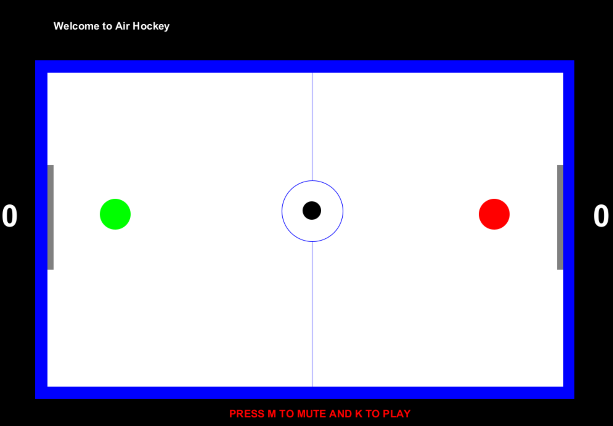

# Air Hockey

A local two-player air hockey game written in Java. Share one keyboard, defend your goal, and use your mallet to send the puck into your opponent's goal. The game includes a graphical table, live scores, a configurable score limit, sound effects, and mallet-size cheats.



## Table of Contents

- [Overview](#overview)
- [Requirements](#requirements)
- [Install Java](#install-java)
- [Download the Project](#download-the-project)
- [Compile and Run](#compile-and-run)
- [How to Play](#how-to-play)
- [Controls](#controls)
- [Cheat Codes](#cheat-codes)
- [Sound Effects](#sound-effects)
- [Source File Guide](#source-file-guide)
- [API Documentation](#api-documentation)
- [Troubleshooting](#troubleshooting)
- [License](#license)

## Overview

- Two players compete on the same computer: Player 1 uses the green mallet on the left, and Player 2 uses the red mallet on the right.
- Each mallet is restricted to its own half of the table.
- The black puck changes direction when hit by a mallet or when it reaches a table boundary. Its velocity gradually decreases between mallet hits.
- Goals update the scoreboard and reset the mallets to their starting positions.
- Players choose a target score at the start and can request another match with Space when a winner is displayed.
- Sound effects accompany startup, mallet hits, wall bounces, and goals.
- Built-in cheats change either player's mallet diameter during play.

The interface uses Java Swing and AWT, and audio uses Java Sound. All required Java classes and game audio files are included. There is no Maven or Gradle setup and no third-party Java library to download.

## Requirements

| Requirement | Details |
| --- | --- |
| Java Development Kit (JDK) | Install a full JDK, including both `java` and `javac`. JDK 25 is a suggested setup version. Compilation was verified with JDK 27; other versions were not tested here. |
| Desktop environment | A graphical desktop is required for the game window and score dialogs. A terminal-only or headless environment is insufficient. |
| Display | Allow room for a fixed 1000 x 700 game area plus the window borders. |
| Input | One keyboard for both players. A mouse with primary and secondary buttons is needed for Player 2's size cheats. |
| Audio | A working audio output device and Java Sound support. Audio initialization happens before gameplay, even if you intend to mute later. |
| Git (optional) | Needed only if you choose to clone the repository instead of downloading a ZIP. |

An IDE is optional. You can compile and run everything from a terminal. Internet access is needed to download the JDK and project; gameplay runs locally without a network connection.

## Install Java

If `java --version` and `javac --version` already work with a suitable JDK, skip to [Download the Project](#download-the-project).

### Windows

1. Open the [Eclipse Temurin JDK download page](https://adoptium.net/temurin/releases/).
2. Select JDK 25, Windows, and the architecture matching your computer. Select the JDK package rather than the JRE.
3. For a Windows x64 computer, download and open the `.msi` installer.
4. Follow the installer prompts. Keep the option to add Java to `PATH` enabled. You can also enable the option to set `JAVA_HOME`.
5. Finish installation, then open a new PowerShell or Command Prompt window so it picks up the updated environment.
6. Run the verification commands below.

See the official [Windows installer instructions](https://adoptium.net/installation/windows/) for details. If an installer is unavailable for your architecture, follow the [archive installation instructions](https://adoptium.net/installation/archives/) for the matching JDK download.

### macOS

1. Open the [Eclipse Temurin JDK download page](https://adoptium.net/temurin/releases/).
2. Select JDK 25, macOS, and the architecture matching your Mac: `aarch64` for Apple silicon or `x64` for Intel.
3. Select JDK and download the `.pkg` installer.
4. Open the installer and follow its prompts to complete installation.
5. Open a new Terminal window and run the verification commands below.

See the official [macOS installer instructions](https://adoptium.net/installation/macOS/) for details.

### Linux

1. Use a Linux desktop session with an audio output device.
2. Open the official [Eclipse Temurin Linux package instructions](https://adoptium.net/installation/linux/).
3. Follow the repository setup steps for your distribution and install the full JDK 25 package. Do not install only a JRE or a headless runtime.
4. Alternatively, download a matching Linux JDK archive from the [download page](https://adoptium.net/temurin/releases/) and follow the [archive installation instructions](https://adoptium.net/installation/archives/).
5. Open a new terminal and run the verification commands below.

### Verify the Installation

```text
java --version
javac --version
```

Both commands should print a version number. Use a compiler and runtime from the same JDK installation. If either command is missing, see [Troubleshooting](#troubleshooting) before continuing.

## Download the Project

Choose either the ZIP method or the Git method. You do not need both.

### Option 1: Download a ZIP Without Git

1. Open the [Air Hockey repository](https://github.com/sahasatyaki/Air-Hockey).
2. Click the green **Code** button and select **Download ZIP**.
3. Extract the entire ZIP to a folder of your choice. Do not run files directly from inside the ZIP.
4. Open the extracted folder containing `README.md`, `LICENSE`, and `airHockey`. Depending on the branch name, it might be named `Air-Hockey-main`.
5. Open a terminal in that folder. On Windows, you can right-click in File Explorer and select **Open in Terminal**. On macOS or Linux, use `cd` to enter the extracted folder.

Keep the source and `.wav` files together; downloading only `main.java` is insufficient.

### Option 2: Clone With Git

1. If needed, install Git using the official [Git installation page](https://git-scm.com/install/), choosing the instructions for your operating system.
2. Open a new terminal and verify it with `git --version`.
3. Navigate to the directory where you want to keep the project.
4. Run:

```sh
git clone https://github.com/sahasatyaki/Air-Hockey.git
cd Air-Hockey
```

## Compile and Run

Start in the repository root: the folder containing this README. The following commands work in PowerShell, Command Prompt, and a macOS or Linux terminal:

```sh
cd airHockey/code/src
javac *.java
java -cp . main
```

Run each command in order. Only launch the game if compilation succeeds.

`javac *.java` compiles all seven Java source files and creates `.class` files beside them. A successful compilation normally produces no terminal output. `java -cp . main` runs the entry class, whose name is lowercase `main`. Do not add `.java` or `.class` to that launch command.

**Keep the terminal's working directory at `airHockey/code/src` when launching.** The game loads its audio using relative filenames such as `fanfare.wav`, so launching from another directory can fail even when the classpath is correct.

After the first successful compilation, start future sessions from that same folder with:

```sh
java -cp . main
```

Recompile if you later change any Java source file. Generated `.class` files are ignored by the repository's `.gitignore`.

### Run From an IDE

1. Open the project or its source folder in a Java-capable IDE.
2. Select your installed JDK as the project's Java SDK.
3. Configure `airHockey/code/src` as the source directory if the IDE requires it.
4. Select `main.java` and its `public static void main(String[] args)` entry point.
5. Set the run configuration's working directory to the full path of `airHockey/code/src`, where the `.wav` files are stored.
6. Build and run the program.

An IDE can put compiled classes in its own output folder, but the runtime working directory must still point to the audio folder. The terminal instructions above are sufficient without installing an IDE or editor extensions.

## How to Play

1. Launch the game. A window titled `Let's Play!` and a score-limit dialog appear.
2. Enter a positive whole number, such as `5`, and confirm. This sets the target score. Enter `0` to quit instead.
3. Give the game window keyboard focus after closing the dialog.
4. Player 1 moves the green mallet with W, A, S, and D. Player 2 moves the red mallet with the arrow keys.
5. Move toward the puck to strike it. There is no separate serve or shoot button.
6. Player 1 scores by sending the puck into the right goal. Player 2 scores by sending it into the left goal. Each goal adds one point.
7. After a goal, both mallets return to their starting positions. The puck resets near the center on the side of the player who conceded, and its velocity is reset.
8. When a player reaches the target score, the welcome area displays the winner. Press Space promptly to request another match, then enter a new positive score limit or `0` to quit.
9. Close the game window at any time to exit. You can also stop a terminal-launched session with Ctrl+C in its terminal.

The current implementation continues processing movement and goals after displaying a winner.

## Controls

Hold a movement key to move continuously. Letter keys do not require Shift.

| Action | Player 1: left, green | Player 2: right, red |
| --- | --- | --- |
| Move up | W | Up Arrow |
| Move down | S | Down Arrow |
| Move left | A | Left Arrow |
| Move right | D | Right Arrow |

| Shared action | Input |
| --- | --- |
| Disable gameplay sound effects | M |
| Enable gameplay sound effects | K |
| Request a new match when the winner message is displayed | Space |
| Quit from a score-limit dialog | Enter `0` and confirm |
| Quit at any time | Close the game window |

Mouse movement does not steer either mallet. Escape, Enter, and Shift have no gameplay action assigned in `main.java`.

## Cheat Codes

Cheats are enabled automatically; there is no console, password, or activation menu. Hold the relevant key or mouse button during gameplay. Mouse buttons must be pressed inside the game area.

| Player using the cheat | Input | Effect | Diameter change per game-loop iteration |
| --- | --- | --- | --- |
| Player 1 | Z | Enlarge the green mallet | +3 pixels |
| Player 1 | X | Shrink the green mallet | -2 pixels |
| Player 1 | C | Shrink the opponent's red mallet | -1 pixel |
| Player 2 | Left mouse button | Enlarge the red mallet | +3 pixels |
| Player 2 | Right mouse button | Shrink the red mallet | -2 pixels |
| Player 2 | B | Shrink the opponent's green mallet | -1 pixel |

The default mallet diameter is 50 pixels. Cheat effects repeat while the input is held, so sizes can change quickly. There are no minimum or maximum size checks: excessive shrinking can make a mallet disappear, and excessive enlargement can interfere with movement. Use short presses for small changes.

Size changes persist through goals and through matches restarted with Space. Close and relaunch the application to restore both mallets to their default sizes.

## Sound Effects

All audio files are included in `airHockey/code/src`; no separate sound download is required.

| File | Use |
| --- | --- |
| `fanfare.wav` | Played at application startup and when requesting a new match. |
| `hit.wav` | Played when a mallet hits the puck, if sound is enabled. |
| `bounce.wav` | Played when the puck reaches a table boundary, if sound is enabled. |
| `applause.wav` | Played when a goal is scored, if sound is enabled. |
| `drumroll.wav` | Included in the repository but not loaded or played by the current game. |

Sound starts enabled. M disables subsequent gameplay hit, bounce, and goal effects; K enables them again and updates the on-screen status. The startup and restart fanfare is played independently of this setting. Muting does not unload audio or necessarily stop a clip that is already playing. There is no continuous background music track.

## Source File Guide

| File | Responsibility |
| --- | --- |
| [main.java](airHockey/code/src/main.java) | Application entry point. Builds the table, mallets, puck, goals, scores, and labels; loads audio; asks for the target score; and runs movement, cheats, sound settings, collisions, scoring, and restart handling. Its `movePuck` method updates puck position and handles table-boundary bounces. |
| [GameArena.java](airHockey/code/src/GameArena.java) | Swing window and drawing surface. Renders balls, rectangles, lines, and text in layer order using a buffered image. Tracks held keyboard and mouse inputs, redraws on a separate thread, and provides timing and window-exit helpers. Made in collaboration with Dr. Joe Finney. |
| [Ball.java](airHockey/code/src/Ball.java) | Circular object model used for the mallets, puck, and center markings. Stores position, diameter, color, layer, and velocity; provides movement and overlap detection. Also contains a separate deflection helper that the game's main loop does not call. |
| [Rectangle.java](airHockey/code/src/Rectangle.java) | Stores rectangle position, dimensions, color, and layer. Used for the blue table border, white playing surface, and gray goal posts. |
| [Line.java](airHockey/code/src/Line.java) | Stores line endpoints, thickness, color, and layer, with optional arrowhead support. Used for the table's dividing line. |
| [Text.java](airHockey/code/src/Text.java) | Stores text content, position, font size, color, and layer. Used for the greeting, scores, winner messages, and audio status. |
| [TransparentRing.java](airHockey/code/src/TransparentRing.java) | A separate Swing component that draws circular outlines and provides a preferred size. It is included in the source tree but is not instantiated by the current game; the game's center markings use `Ball` objects instead. |

## API Documentation

Pre-generated class documentation is included in [Javadocs/index.html](Javadocs/index.html). To read it as a website, download the repository and open that file in a local web browser. GitHub's normal file view does not render it as a documentation site.

The Java files also contain inline comments and Javadoc descriptions for the drawing objects and arena helpers. Some comments describe earlier implementation intentions; the control tables and behavior notes in this README follow the executable game logic.

## Troubleshooting

| Symptom | What to check |
| --- | --- |
| `java` or `javac` is not recognized, or reports `command not found` | Install a full JDK, enable or configure its `bin` directory on `PATH`, and reopen the terminal. Having only a JRE is insufficient for compilation. |
| Multiple Java installations cause confusion | On Windows, use `where.exe java` and `where.exe javac`. On macOS or Linux, use `command -v java` and `command -v javac`. Ensure both resolve to the intended JDK. |
| `file not found: *.java` | Enter `airHockey/code/src` before compiling. That folder must contain all seven `.java` files. |
| `Could not find or load main class main` | Compile successfully first, stay in the source folder, and use `java -cp . main` with lowercase `main`. Confirm `main.class` exists there. |
| `UnsupportedClassVersionError` | The runtime is older than the compiler used to build the classes. Use the same JDK for compilation and execution, then recompile. |
| `FileNotFoundException` mentioning a `.wav` file | Launch with `airHockey/code/src` as the working directory. Extract the full repository and keep the bundled `.wav` files in that folder. Setting only the classpath does not fix relative audio paths. |
| `UnsupportedAudioFileException` | Restore the original bundled `.wav` files if they were replaced or damaged. Changing a file extension does not convert its audio format. |
| `LineUnavailableException` or an unavailable audio clip error | Check that the computer has an enabled audio output device and Java Sound can open it. Try closing applications using the device exclusively. The game loads audio before its mute controls become available. |
| `HeadlessException` or a display connection error | Run from a graphical desktop session with a full desktop-capable JDK. A server console, headless container, or online Java runner may lack the required display and audio support. |
| Score input causes `NumberFormatException` | Enter a positive whole number without spaces, such as `5`, or `0` to quit. Empty input, text, decimals, and cancelling the dialog are not handled. Close and relaunch the window after an invalid-input failure. |
| Keyboard controls do not respond | Finish the score dialog and give the game window focus. If you click inside the game area, remember that the left mouse button enlarges the red mallet. |
| Mallet is invisible or too large | Size cheats have no bounds. Close and relaunch the game to restore the default diameter; Space does not reset sizes. |
| Part of the window is outside the screen | The game window cannot be resized. Use a display resolution and desktop scaling that leave enough space for the game area and window decorations. |
| The game stays open after a startup error | The window and rendering thread can start before audio loading or input processing fails. Close the game window, fix the reported error, and launch again. |

## License

This repository includes an [MIT License](LICENSE). See that file for the copyright notice and full license terms.